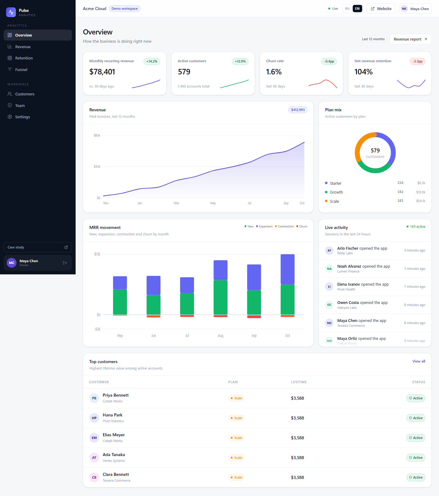

# Pulse

**Product analytics dashboard for SaaS teams.**
Second portfolio case: MRR movement, cohort retention, activation funnel and account health — all computed from invoices and product events.

[](https://github.com/bakkka/pulse/actions/workflows/ci.yml)



<sub>Русская версия: [overview-ru.png](docs/screenshots/overview-ru.png) · [landing-ru.png](docs/screenshots/landing-ru.png)</sub>

## What's inside

- **Overview** — MRR, active customers, churn, NRR, revenue trend, MRR movement, plan mix, live sessions, top accounts by lifetime value.
- **Revenue** — 3/6/12-month ranges, MRR history, new / expansion / contraction / churn, net new MRR, latest invoices.
- **Retention** — 12 monthly cohorts in a heatmap plus a size-weighted retention curve.
- **Funnel** — signup → activated → project → team → paid, step conversion, biggest drop-off, average time to convert, sources.
- **Customers** — search, plan/status filters, sorting, pagination, CSV export, account detail with invoices, events and plan changes.
- **Team** — owner / admin / viewer roles, invites, role changes, removal. Permissions are enforced server-side.
- **Settings** — workspace, currency, timezone, demo reset.

**Bilingual UI:** RU/EN switcher in the header and on the landing. Dates, chart month labels, cohort labels, statuses and all UI copy follow the locale; the data stays in USD.

The interface is English by default (international SaaS register) and switches to Russian in one click.

## Demo accounts

Password for all: **`pulse`**

| Role | Email | What it can do |
| --- | --- | --- |
| Owner | `owner@pulse.app` | everything, including team + demo reset |
| Admin | `admin@pulse.app` | edit customers and workspace |
| Viewer | `viewer@pulse.app` | read-only |

## Quick start

```bash
npm install
npm run setup      # schema + deterministic seed (1,400 accounts, ~3,600 invoices, ~13,800 events)
npm run dev        # http://localhost:3200
```

Production build:

```bash
npm run build
npm run start      # http://localhost:3200
```

## Stack

| Layer | Tech |
| --- | --- |
| Frontend | Next.js 15 (App Router), React 19, TypeScript, Tailwind CSS |
| Backend | Server Actions, Prisma ORM, SQLite locally → Postgres in production |
| Charts | Hand-built SVG (area, diverging bars, donut, heatmap, sparkline) |
| Auth | scrypt hashes, HMAC-signed httpOnly sessions, server-side RBAC |
| i18n | Cookie-based RU/EN dictionaries, localized dates and labels |

No chart library, no UI kit: the charts are small components with hover state, which keeps the bundle at ~116 kB First Load JS.

## How the metrics are computed

This is the part that makes the screenshots honest.

| Metric | Definition |
| --- | --- |
| **MRR at a date** | Sum of each live customer's latest invoice issued on or before that date. Upgrades and downgrades show up naturally. |
| **Active customers** | Customers who have at least one invoice and have not churned by the date. |
| **New MRR** | First invoice of a customer inside the period. |
| **Expansion / contraction** | Positive / negative delta against the same customer's previous invoice. |
| **Churned MRR** | Last invoice amount of customers whose `churnedAt` falls inside the period. |
| **NRR** | `(start MRR + expansion − contraction − churn) / start MRR`. |
| **Churn rate** | Churned paying customers / paying customers at period start. |
| **Cohort retention** | Share of a signup cohort with at least one `session` event in month *N*. |
| **Funnel** | Distinct customers per event, counted inside signup cohorts of the selected window. |

The metrics module (`src/lib/analytics.ts`) is one file: dates are passed in explicitly, charts never compute business logic.

## Data model

```
Customer ──< Invoice        revenue, MRR history, movement
Customer ──< Event          cohorts, funnel, live activity
Customer >── Plan
Customer >── Member (owner)
Member                     roles: owner / admin / viewer
Workspace, Setting
```

The seed (`prisma/demo-data.ts`) is deterministic: same data on every run, so screenshots and demos are reproducible.

## Structure

```
src/
  app/
    page.tsx                 marketing landing with live preview
    login/                   role-based demo sign-in
    app/                     dashboard shell + 7 screens
    actions.ts               server actions (auth, team, customers, demo)
    api/export/customers     CSV export
  components/                UI kit, SVG charts, navigation, locale switch
  lib/                       analytics, auth, sessions, formatting, i18n, locale
prisma/
  schema.prisma
  demo-data.ts               deterministic generator
docs/
  case-study.md              problem → decisions → metric definitions
  screenshots/               ten PNGs used in this README
```

## Deploy notes

1. Postgres (Neon/Supabase): change `provider` in `prisma/schema.prisma`, set `DATABASE_URL`.
2. Vercel: `DATABASE_URL`, `PULSE_SESSION_SECRET`, `NEXT_PUBLIC_APP_URL`.
3. Seed once: `npx prisma db push && npm run db:seed`.

> Demo data is synthetic and invoices are simulated. Built as a portfolio case, not a production billing system.
